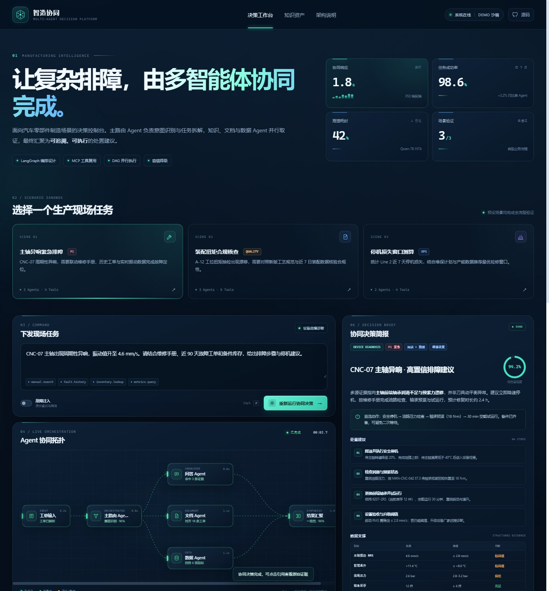

# 智造协同 · 多智能体协同决策平台 Demo

面向**汽车零部件制造场景**的交互式多 Agent 决策控制台。主路由 Agent 完成意图识别与 DAG 任务拆解，知识问答、文档处理与数据查询 Agent 并行取证，最终汇聚为可追溯、可执行的现场处置建议。

> 在线体验：**https://carrotrain4.github.io/multi-agent-decision-demo/**
>
> 本页面为个人实践项目的交互式前端原型。Agent 执行轨迹、MCP 调用与容错流程由浏览器内的状态机模拟，所有企业、设备与业务数据均为虚构演示数据。



## 一个任务如何被完成

```text
现场工单
   ↓
主路由 Agent ── 意图识别 / DAG 拆解
   ├── 问答 Agent ── manual.search / RAG 证据召回
   ├── 文档 Agent ── fault.history / 工单对齐
   └── 数据 Agent ── sql.query / 指标与库存查询
   ↓
结果汇聚 Agent ── 交叉验证 / 置信度评估
   ↓
可执行决策简报 + 数据支撑 + 引用来源
```

## 可交互体验

打开页面后会自动运行一次「主轴异响紧急排障」场景，也可以手动切换以下场景：

| 场景 | 协同链路 | 展示重点 |
| --- | --- | --- |
| **主轴异响紧急排障** | 3 个 Agent 并行 | 维修手册检索、历史工单对齐、振动/库存数据交叉验证 |
| **装配扭矩合规核查** | 3 个 Agent 并行 | 新版 SOP 与 QMS 抽检数据比对、合规风险识别 |
| **停机损失窗口测算** | 2 个 Agent 并行 | 动态裁撤文档 Agent，聚合 MES / APS 数据推荐检修窗口 |

页面中还包含：

- **实时协同拓扑**：节点状态、并行连线和任务耗时同步变化。
- **执行事件流**：按时间展示上下文路由、工具调用、结果聚合过程。
- **证据追溯**：点击任意引用，可查看文档位置、原文片段与重排相关性。
- **故障注入**：开启后运行任务，可观察数据 MCP 超时、指数退避、缓存快照降级与置信度下调。
- **熔断演练**：完整演示 `CLOSED → OPEN → HALF_OPEN → CLOSED` 状态迁移。
- **简报导出**：支持一键复制结论或下载 Markdown 决策简报。

## 架构设计要点

- **分层编排**：交互层 → 编排层 → 能力层 → MCP 工具层 → 数据层。
- **DAG 并行**：拆解后的子任务并行执行，异步聚合结果，前端按事件流逐步呈现。
- **动态路由**：场景不需要的能力会被裁剪。例如停机分析场景不会调用文档 Agent。
- **容错熔断**：连续失败 5 次触发熔断，半开状态探测恢复；工具超时按指数退避重试，最多 3 次。
- **降级保底**：工具链路不可用时切换 Redis 快照与规则引擎，结果显式标注降级状态。
- **可追溯输出**：结论绑定文档、页码/工单与相关性得分，便于人工复核。

### 关于当前 Demo 的实现边界

为了让面试官打开链接即可体验，本项目使用**无依赖的原生 HTML / CSS / JavaScript** 实现，包含：

- Agent 编排状态机；
- 并行任务模拟与事件流；
- 重试、降级、熔断状态机；
- 证据抽屉、简报复制与 Markdown 导出；
- 三套业务场景的结果模板。

生产版本可将页面中的事件协议接入 `LangGraph + FastAPI + SSE` 后端，并将模拟结果替换为真实模型与 MCP 工具返回。简历中的 LangGraph、RAG、MCP、Redis 等为项目方案设计与技术学习背景，不应把本静态 Demo 本身理解为完整生产系统。

## 本地运行

项目没有构建步骤，也不需要安装依赖：

```bash
# 在项目目录执行
python -m http.server 8000
```

然后访问 `http://localhost:8000/`。

也可以直接双击 `index.html` 打开；建议使用本地 HTTP 服务以获得更稳定的剪贴板等浏览器能力。

## 文件结构

```text
.
├── index.html          # 页面结构与场景内容
├── styles.css          # 响应式视觉系统与动效
├── app.js              # 编排状态机、场景数据与交互逻辑
├── favicon.svg         # 站点图标
├── preview.jpg         # README 预览图
├── .nojekyll           # GitHub Pages 配置
└── README.md
```

## 技术栈

- HTML5 / CSS3 / Vanilla JavaScript
- CSS Grid、响应式布局、SVG 协同拓扑
- `prefers-reduced-motion` 无障碍适配
- GitHub Pages 静态部署

---

用于 AI 应用开发岗位面试展示 · 2026
